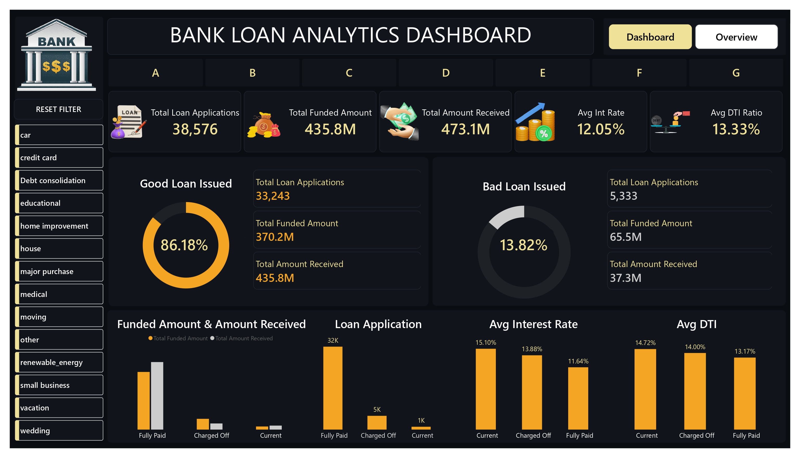

# 🏦 Bank Loan Analytics Dashboard

## 📌 Project Overview

The Bank Loan Analytics Dashboard is a data analytics and business intelligence project developed to analyze loan portfolio performance and monitor banking lending operations.

The project focuses on evaluating loan applications, funded amounts, repayments, interest rates, and borrower Debt-to-Income (DTI) ratios. It provides insights into Good Loans vs Bad Loans, repayment behavior, loan distribution, and regional lending patterns.

An interactive Power BI dashboard is designed to transform loan-related data into meaningful visual insights, helping stakeholders monitor portfolio health, identify trends, and make data-driven lending decisions.

## 🎯 Project Objectives

- Analyze overall loan portfolio performance and lending operations.
- Track Good Loans vs Bad Loans and repayment behavior.
- Monitor key performance indicators (KPIs).
- Evaluate funded amounts and total repayments.
- Analyze average interest rates and Debt-to-Income (DTI) ratios.
- Understand monthly loan application trends.
- Perform regional analysis of loan distribution.
- Identify loan purposes, terms, and home ownership patterns.
- Build an interactive Power BI dashboard for portfolio insights.

## 📊 Key Performance Indicators (KPIs)

The dashboard tracks the following important metrics:

- **Total Loan Applications:** Total number of loan applications received during a specified period.
- **Total Funded Amount:** Total amount of funds disbursed as loans.
- **Total Amount Received:** Total amount received from borrowers through loan repayments.
- **Average Interest Rate:** Average interest rate across all loans.
- **Average DTI Ratio:** Average Debt-to-Income ratio of borrowers.

## 📈 Dashboard Features

### 1. Summary Dashboard

Provides an overview of the bank's lending activities and overall loan portfolio performance.

**Visualizations:**
- Donut Chart – Good Loan Applications
- Donut Chart – Bad Loan Applications
- Funded Amount vs Repayment by Loan Status
- Loan Status-wise Loan Applications
- Average Interest Rate by Loan Status
- Average DTI Ratio by Loan Status

### 2. Overview Dashboard

Provides detailed insights into loan application trends, regional distribution, and borrower characteristics.

**Visualizations:**
- Line Chart – Monthly Loan Applications
- Filled Map – Regional Analysis
- Donut Chart – Loan Term Analysis
- Bar Chart – Home Ownership Analysis
- Tree Map – Loan Purpose Breakdown

## 🎛️ Interactive Features

- Purpose-based filtering
- Grade-based filtering
- Interactive page navigation buttons
- Reset Filters button
- Dynamic dashboard exploration

## 🎨 Dashboard Design

The dashboard follows a dark-themed design with gold accents to provide a professional financial analytics interface.

| Design Element | Color Code |
|---|---|
| Canvas Background | `#0B0D12` |
| Visual Background | `#11151C` |
| Borders | `#232A35` |
| Gold Accent | `#F5A524` |
| KPI Values | `#F0E199` |
| Titles | White |

## 🛠️ Tools & Technologies

- Microsoft Power BI
- Data Analytics
- Data Visualization
- Business Intelligence

## 💡 Project Outcomes

- Provides a comprehensive view of loan portfolio performance.
- Helps monitor lending activities and repayment behavior.
- Identifies patterns in Good Loans and Bad Loans.
- Enables analysis of loan applications across different periods.
- Provides insights into regional lending distribution and loan purposes.
- Supports data-driven decisions through interactive visualizations.

